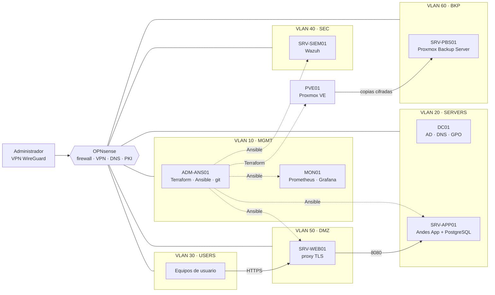

# Andes · infraestructura empresarial completa en una sola PC

Red segmentada, Active Directory, PKI propia, infraestructura como código, CI/CD, observabilidad, SIEM y recuperación
ante desastres de una empresa ficticia (**Andes Logística**, dominio `corp.lab.internal`), desplegados y operados en un
portátil con Proxmox VE anidado en VMware Workstation. Todo lo que se puede automatizar está en este repositorio; todo
lo que se afirma aquí se midió.

> Entorno de **laboratorio**: direcciones privadas, dominio interno y licencias de evaluación. No es una guía de producción.

> **Versión pública.** Es el mismo código y la misma documentación que el repositorio de trabajo, sin historial y sin
> los dos archivos cifrados con Ansible Vault (los secretos y la copia de OPNsense). Su estructura se documenta en
> [vault.yml.example](ansible/group_vars/all/vault.yml.example) y [backups/opnsense](backups/opnsense/README.md).



Más diagramas (flujos del firewall, dependencias, copias, flujo de cambios): [docs/diagramas](docs/diagramas/README.md).

## Resultados medidos

| Área | Resultado |
|---|---|
| Infraestructura | 10 VM en Proxmox, 6 VLAN y 12 flujos de firewall documentados; denegación por defecto entre segmentos |
| Infraestructura como código | Servidor destruido y reconstruido desde git en **7 min 19 s** sin pasos manuales; VM nueva en 2 min 31 s; segunda pasada de Ansible con `changed=0` |
| CI/CD | gitleaks (historial completo), Terraform, ansible-lint (perfil *production*), Trivy y publicación de la imagen de la app en GHCR; actions fijadas por SHA |
| Endurecimiento | Lynis 63 → **83**; CIS Ubuntu 24.04 de 53 % a **63 %**; SSH solo con clave y solo desde la red de gestión y la VPN |
| Vulnerabilidades | **−79 %** en total (19.784 → 4.062), críticas **−89 %**, altas −83 % en un ciclo de parcheo de 1 h 06 min |
| Detección | Wazuh con 6 casos de uso mapeados a MITRE ATT&CK y 2 reglas propias; incidente simulado con **MTTD 5 s** y MTTR 26 min |
| Observabilidad | Prometheus, Grafana y Alertmanager; SLO de disponibilidad del 99 % con informe semanal |
| Recuperación ante desastres | 6 simulacros superados: VM restaurada en **5 min 19 s**, servidor reconstruido + base de datos en 7 min 11 s (RPO 12 h), firewall en 3 min 38 s, usuario de AD en 0,05 s, copia corrupta detectada y reparada |
| Operación | Parcheo con Ansible, revisión semanal y de accesos automáticas con informe en git, capacidad del hipervisor en Grafana |

Detalle de cada medida: [docs/dr/resultados-simulacros.md](docs/dr/resultados-simulacros.md), [docs/incidents/INC-0001.md](docs/incidents/INC-0001.md), [docs/operacion](docs/operacion/README.md).

## Qué hay y dónde

| Competencia | Qué se hizo | Dónde |
|---|---|---|
| Virtualización | Proxmox VE 9 anidado, plantillas cloud-init, perfiles de encendido | [ADR-0001](docs/adr/ADR-0001-proxmox-anidado.md) |
| Redes y seguridad perimetral | OPNsense, 6 VLAN, matriz de flujos, VPN WireGuard como única vía de administración | [ADR-0002](docs/adr/ADR-0002-seis-vlan.md) |
| Identidad | AD en Windows Server Core, AGDLP, GPO, delegación, Linux unidos con SSSD/Kerberos | [ADR-0003](docs/adr/ADR-0003-server-core.md), [rol ad_member](ansible/roles/ad_member) |
| PKI | CA raíz + emisora propias; TLS en todos los servicios internos | [ADR-0006](docs/adr/ADR-0006-ca-intermedia.md) |
| Infraestructura como código | Terraform (bpg/proxmox) con importación de VM existentes; estado fuera de Git | [terraform/](terraform), [ADR-0004](docs/adr/ADR-0004-estado-terraform.md), [ADR-0005](docs/adr/ADR-0005-terraform-bpg.md) |
| Gestión de configuración | Ansible: 9 roles idempotentes, secretos en Vault, reconstrucción en un comando | [ansible/](ansible), [scripts/reconstruir-servidor.sh](scripts/reconstruir-servidor.sh) |
| CI/CD y seguridad de la cadena | GitHub Actions con gitleaks, lint, Trivy e imagen en GHCR | [.github/workflows/ci.yml](.github/workflows/ci.yml) |
| Contenedores | Andes App (Flask + PostgreSQL) en Docker sin root, solo lectura, imagen escaneada | [rol andes_app](ansible/roles/andes_app) |
| Observabilidad | Métricas, alertas a Telegram, SLO, capacidad del anfitrión | [monitoring/](monitoring), [docs/operacion/capacidad.md](docs/operacion/capacidad.md) |
| SIEM y respuesta | Wazuh, FIM con who-data, respuesta activa, runbook y post-mortem | [RB-IR-01](docs/runbooks/RB-IR-01.md), [INC-0001](docs/incidents/INC-0001.md) |
| Copias y continuidad | Proxmox Backup Server cifrado, regla 3-2-1, ventana diaria de copias, plan de continuidad | [docs/dr](docs/dr/plan-continuidad.md), [ADR-0007](docs/adr/ADR-0007-pbs-ventana-copias.md) |
| Operación | ADR, runbooks, gestión de cambios, inventario automático, rutinas programadas | [docs/](docs/README.md) |

## Cómo reproducirlo

**Requisitos:** un PC con 32 GB de RAM, CPU con virtualización anidada (AMD-V/VT-x), unos 400 GB libres y VMware
Workstation. En Windows hay que desactivar la integridad de memoria (HVCI) para que VMware exponga la virtualización.

**Orden de construcción** (cada paso depende del anterior):
1. Proxmox VE como VM de VMware y plantilla Ubuntu 24.04 con cloud-init.
2. OPNsense: VLAN, matriz de flujos, DNS/NTP y VPN WireGuard.
3. DC01 (Windows Server Core) y dominio; PKI en OPNsense.
4. ADM-ANS01 como único punto de administración; desde ahí, Terraform y Ansible:
   ```bash
   source ~/.secrets/pve-terraform.env          # token de Proxmox (nunca en el repositorio)
   terraform -chdir=terraform apply             # VM declaradas en servers.auto.tfvars
   cd ansible && ansible-playbook site.yml      # línea base, agentes, Docker, app, proxy, unión a AD
   ```
5. Monitorización, SIEM y Proxmox Backup Server; después, las rutinas de [docs/operacion](docs/operacion/README.md).

Para operarlo: [docs/README.md](docs/README.md) (primeros pasos) y [docs/runbooks](docs/runbooks/README.md).

## Limitaciones (honestas)

- **Un único anfitrión físico** con virtualización anidada: sin alta disponibilidad real y con sobrecarga de rendimiento.
- **Memoria ajustada** (20 GB para todo): el SIEM y el servidor de copias no caben a la vez y se alternan en una ventana
  diaria; las VM nuevas exigen perfiles de encendido.
- **Copias en el mismo disco físico** (la segunda, en otra carpeta del anfitrión); sin copia fuera del sitio (riesgo aceptado).
- **Licencias de evaluación** de Windows Server y un dominio `.internal` no público.
- En producción haría falta: clúster de 3 nodos con almacenamiento compartido (Ceph), segundo controlador de dominio,
  SIEM distribuido, copia externa cifrada y la protección de ramas aplicada (requiere un plan de GitHub de pago en
  repositorios privados).

## Licencia

Código bajo [MIT](LICENSE); documentación bajo [CC BY 4.0](https://creativecommons.org/licenses/by/4.0/deed.es).
Autor: Erick Guarnizo.
