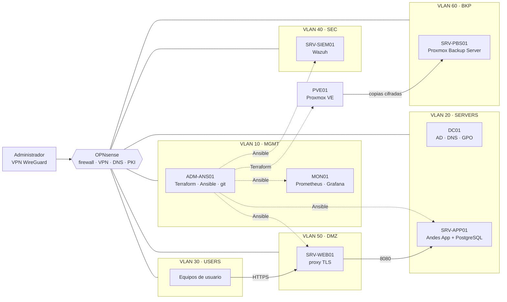

# Andes · infraestructura empresarial completa en una sola PC

**Autor: Erick Guarnizo** · Infraestructura · Ciberseguridad · DevOps

Red segmentada, Active Directory, PKI propia, infraestructura como código, CI/CD, observabilidad, SIEM y recuperación
ante desastres de una empresa ficticia (**Andes Logística**, dominio `corp.lab.internal`), desplegados y operados en un
portátil con Proxmox VE anidado en VMware Workstation. Todo lo que se puede automatizar está en este repositorio; todo
lo que se afirma aquí se midió.

> Entorno de **laboratorio**: direcciones privadas, dominio interno y licencias de evaluación. No es una guía de producción.

> **Versión pública.** Es el mismo código y la misma documentación que el repositorio de trabajo, sin historial y sin
> los dos archivos cifrados con Ansible Vault (los secretos y la copia de OPNsense). Su estructura se documenta en
> [vault.yml.example](ansible/group_vars/all/vault.yml.example) y [backups/opnsense](backups/opnsense/README.md).

---

## En 30 segundos (para quien no es técnico)

Imagina una empresa de logística con oficinas, empleados, una página web para sus clientes y datos que proteger.
Necesita una **red** que separe a los empleados de los servidores, **cuentas de usuario** centralizadas, una
**aplicación web** publicada en Internet, alguien que **vigile** que todo funciona, un sistema que **detecte ataques** y
**copias de seguridad** por si algo sale mal.

Este proyecto construye **todo eso desde cero**, como lo haría el departamento de TI de una empresa real, pero dentro
de un solo portátil. Y no se queda en «instalarlo»: se **automatiza** (los servidores se crean y configuran solos a
partir de código), se **ataca** (se simula un incidente y se mide cuánto tarda en detectarse) y se **rompe a propósito**
(se destruyen servidores y se recuperan, cronometrando el tiempo).

| Lo que se demostró | El dato medido |
|---|---|
| Un servidor destruido se reconstruye solo desde el código | **7 min 19 s**, sin pasos manuales |
| Un cambio malicioso en la web se detecta | en **5 segundos** |
| Las vulnerabilidades de los servidores se reducen | **−79 %** en un ciclo de parcheo de 1 h |
| La seguridad de los servidores mejora (auditoría Lynis) | de **63 a 83** puntos |
| Las copias de seguridad funcionan de verdad | **6 de 6** simulacros de recuperación superados |

Explicación completa, fase por fase y con los problemas reales que hubo que resolver: **[Guía del proyecto](docs/GUIA-DEL-PROYECTO.md)**.
Todo el paso a paso con 434 capturas de pantalla: **[Bitácora de implementación (PDF, 185 páginas)](docs/bitacora/README.md)**.
¿Algún término no te suena? **[Glosario](docs/GLOSARIO.md)**.

---

## La empresa ficticia: Andes Logística

| Área | Qué necesita la empresa | Cómo se resolvió |
|---|---|---|
| Red | Que un equipo infectado de un empleado no llegue a los servidores | 6 redes separadas (VLAN) con un firewall entre ellas que lo bloquea todo salvo lo autorizado |
| Acceso remoto | Que el administrador entre de forma segura | VPN WireGuard: es la **única** puerta de administración |
| Usuarios | Una cuenta por empleado y permisos por departamento | Active Directory con grupos, políticas (GPO) y servidores Linux unidos al dominio |
| Web para clientes | Publicar la aplicación sin exponer la base de datos | Aplicación en contenedores detrás de un proxy en una zona aislada (DMZ) con HTTPS |
| Certificados | Que todas las conexiones internas vayan cifradas | Autoridad de certificación propia (raíz + emisora) |
| Vigilancia | Saber que algo falla antes de que se quejen los clientes | Prometheus + Grafana con alertas a Telegram y un objetivo de disponibilidad del 99 % |
| Seguridad | Detectar ataques y responder | SIEM Wazuh con reglas mapeadas a MITRE ATT&CK, incidente simulado con informe |
| Continuidad | Sobrevivir a la pérdida de un servidor | Copias cifradas y verificadas cada noche en Proxmox Backup Server, regla 3-2-1, simulacros |
| Orden | Que otra persona pueda operarlo | Decisiones documentadas (ADR), procedimientos (runbooks), gestión de cambios e inventario automático |

## Arquitectura



**Cómo leer el diagrama.** Todo vive dentro de un portátil con Windows 11: VMware ejecuta **Proxmox VE** (el
hipervisor de la «empresa») y Proxmox ejecuta las 10 máquinas virtuales. El firewall **OPNsense** es el único camino
entre redes. Cada red tiene un propósito:

| VLAN | Red | Para qué | Quién vive ahí |
|---|---|---|---|
| 10 MGMT | 10.10.10.0/24 | Administración: desde aquí se gestiona todo | ADM-ANS01 (Terraform, Ansible), MON01 (monitorización) |
| 20 SERVERS | 10.10.20.0/24 | Servidores internos | DC01 (Active Directory), SRV-APP01 (aplicación + base de datos) |
| 30 USERS | 10.10.30.0/24 | Equipos de los empleados | Clientes con DHCP |
| 40 SEC | 10.10.40.0/24 | Seguridad, aislada del resto | SRV-SIEM01 (Wazuh) |
| 50 DMZ | 10.10.50.0/24 | Lo que se publica hacia fuera | SRV-WEB01 (proxy HTTPS) |
| 60 BKP | 10.10.60.0/24 | Copias de seguridad, lo más aislado | SRV-PBS01 (Proxmox Backup Server) |

Regla de oro: **todo está bloqueado entre redes salvo 12 flujos documentados** (por ejemplo: «los empleados pueden
abrir la web por HTTPS»). Si el servidor web de la DMZ es comprometido, no puede llegar al controlador de dominio:
está probado. Más diagramas (flujos del firewall, dependencias, copias, flujo de cambios): [docs/diagramas](docs/diagramas/README.md).

## Cómo se construyó: 11 fases

Cada fase se apoya en la anterior. El detalle (objetivo, decisiones, problemas reales y resultado) está en la
**[Guía del proyecto](docs/GUIA-DEL-PROYECTO.md)**.

| Fase | Qué se construyó | Resultado clave |
|---|---|---|
| 0 · Anfitrión | Preparar el portátil para virtualización anidada | Proxmox puede ejecutar VM dentro de VMware |
| 1 · Hipervisor | Proxmox VE 9 y plantilla Ubuntu con cloud-init | Un servidor nuevo listo en minutos |
| 2 · Red | OPNsense, 6 VLAN, matriz de flujos, DNS y VPN | Denegación por defecto entre redes |
| 3 · Identidad | Active Directory, GPO y Linux unidos al dominio | Un usuario, una contraseña, permisos por grupo |
| 4 · Servidores | Linux endurecidos y PKI interna | Lynis 63 → 83, TLS en todos los servicios |
| 5 · Aplicaciones | App en Docker + proxy en la DMZ | Contenedores sin root, imagen escaneada |
| 6 · Observabilidad | Métricas, alertas y SLO | Alertas a Telegram, SLO del 99 % |
| 7 · Seguridad defensiva | SIEM, vulnerabilidades e incidente simulado | Detección en 5 s, vulnerabilidades −79 % |
| 8 · Automatización | Terraform, Ansible y CI en GitHub Actions | Servidor reconstruido desde git en 7 min 19 s |
| 9 · Copias y DR | Proxmox Backup Server y simulacros | 6/6 simulacros superados |
| 10 · Operación | Runbooks, cambios, inventario y rutinas | Revisiones automáticas con informe en git |
| 11 · Publicación | Revisión de secretos, README y vídeo | Este repositorio, auditado con gitleaks |

## Resultados medidos

| Área | Resultado |
|---|---|
| Infraestructura | 10 VM en Proxmox, 6 VLAN y 12 flujos de firewall documentados; denegación por defecto entre segmentos |
| Infraestructura como código | Servidor destruido y reconstruido desde git en **7 min 19 s** sin pasos manuales; VM nueva en 2 min 31 s; segunda pasada de Ansible con `changed=0` |
| CI/CD | gitleaks (historial completo), Terraform, ansible-lint (perfil *production*), Trivy y publicación de la imagen de la app en GHCR; actions fijadas por SHA |
| Endurecimiento | Lynis 63 → **83**; CIS Ubuntu 24.04 de 53 % a **63 %**; SSH solo con clave y solo desde la red de gestión y la VPN |
| Vulnerabilidades | **−79 %** en total (19.784 → 4.062), críticas **−89 %**, altas −83 % en un ciclo de parcheo de 1 h 06 min |
| Detección | Wazuh con 6 casos de uso mapeados a MITRE ATT&CK y 2 reglas propias; incidente simulado con **MTTD 5 s** y MTTR 26 min |
| Observabilidad | Prometheus, Grafana y Alertmanager; SLO de disponibilidad del 99 % con informe semanal |
| Recuperación ante desastres | 6 simulacros superados: VM restaurada en **5 min 19 s**, servidor reconstruido + base de datos en 7 min 11 s (RPO 12 h), firewall en 3 min 38 s, usuario de AD en 0,05 s, copia corrupta detectada y reparada |
| Operación | Parcheo con Ansible, revisión semanal y de accesos automáticas con informe en git, capacidad del hipervisor en Grafana |

Detalle de cada medida: [docs/dr/resultados-simulacros.md](docs/dr/resultados-simulacros.md), [docs/incidents/INC-0001.md](docs/incidents/INC-0001.md), [docs/operacion](docs/operacion/README.md).

## Problemas reales que hubo que resolver

Un laboratorio que «sale a la primera» no enseña mucho. Estos son algunos problemas reales, cómo se diagnosticaron y
qué se cambió para que no vuelvan a pasar (detalle en la [guía](docs/GUIA-DEL-PROYECTO.md)):

| Problema | Causa | Solución permanente |
|---|---|---|
| El SIEM se quedaba sin memoria | El *ballooning* de Proxmox le quitaba RAM a Wazuh | Memoria fija para el SIEM y perfiles de encendido |
| Tras un apagón, la VPN y los certificados fallaban | Todos los relojes del laboratorio iban 2 h 46 min atrasados | Procedimiento de resincronización (Proxmox, OPNsense, DC01) documentado como cambio de emergencia |
| Al reconstruir un servidor desde código, quedó fuera del dominio | La unión a Active Directory se había hecho a mano | Nuevo rol de Ansible `ad_member` con una cuenta delegada de mínimo privilegio |
| El hipervisor dejó de arrancar al añadir un disco | La BIOS cambió el orden de arranque | Orden de arranque fijado y aviso en el script que añade discos |
| El parcheo dejaba servicios «caídos» | Un paquete recomendado (`ipmitool`) instalaba un servicio sin hardware | El rol de parcheo lo purga y verifica 0 unidades caídas |
| No cabían el SIEM y el servidor de copias a la vez | 20 GB de RAM para 10 VM | Ventana diaria de copias a las 22:00: el SIEM se apaga, se copia todo y vuelve a arrancar |

## Qué hay y dónde

| Competencia | Qué se hizo | Dónde |
|---|---|---|
| Virtualización | Proxmox VE 9 anidado, plantillas cloud-init, perfiles de encendido | [ADR-0001](docs/adr/ADR-0001-proxmox-anidado.md) |
| Redes y seguridad perimetral | OPNsense, 6 VLAN, matriz de flujos, VPN WireGuard como única vía de administración | [ADR-0002](docs/adr/ADR-0002-seis-vlan.md) |
| Identidad | AD en Windows Server Core, AGDLP, GPO, delegación, Linux unidos con SSSD/Kerberos | [ADR-0003](docs/adr/ADR-0003-server-core.md), [rol ad_member](ansible/roles/ad_member) |
| PKI | CA raíz + emisora propias; TLS en todos los servicios internos | [ADR-0006](docs/adr/ADR-0006-ca-intermedia.md) |
| Infraestructura como código | Terraform (bpg/proxmox) con importación de VM existentes; estado fuera de Git | [terraform/](terraform), [ADR-0004](docs/adr/ADR-0004-estado-terraform.md), [ADR-0005](docs/adr/ADR-0005-terraform-bpg.md) |
| Gestión de configuración | Ansible: 9 roles idempotentes, secretos en Vault, reconstrucción en un comando | [ansible/](ansible), [scripts/reconstruir-servidor.sh](scripts/reconstruir-servidor.sh) |
| CI/CD y seguridad de la cadena | GitHub Actions con gitleaks, lint, Trivy e imagen en GHCR | [.github/workflows/ci.yml](.github/workflows/ci.yml) |
| Contenedores | Andes App (Flask + PostgreSQL) en Docker sin root, solo lectura, imagen escaneada | [rol andes_app](ansible/roles/andes_app) |
| Observabilidad | Métricas, alertas a Telegram, SLO, capacidad del anfitrión | [monitoring/](monitoring), [docs/operacion/capacidad.md](docs/operacion/capacidad.md) |
| SIEM y respuesta | Wazuh, FIM con who-data, respuesta activa, runbook y post-mortem | [RB-IR-01](docs/runbooks/RB-IR-01.md), [INC-0001](docs/incidents/INC-0001.md) |
| Copias y continuidad | Proxmox Backup Server cifrado, regla 3-2-1, ventana diaria de copias, plan de continuidad | [docs/dr](docs/dr/plan-continuidad.md), [ADR-0007](docs/adr/ADR-0007-pbs-ventana-copias.md) |
| Operación | ADR, runbooks, gestión de cambios, inventario automático, rutinas programadas | [docs/](docs/README.md) |

## Mapa del repositorio

```
.
├── terraform/          Máquinas virtuales declaradas como código (Proxmox)
├── ansible/            Configuración de los servidores en 9 roles + playbooks
│   ├── roles/          hardening, ad_member, andes_app, nginx_proxy, wazuh_agent, node_exporter, patching…
│   └── group_vars/     Variables (los secretos van cifrados con Vault; aquí, solo la plantilla)
├── .github/workflows/  CI: gitleaks, Terraform, ansible-lint, Trivy y publicación de la imagen
├── monitoring/         Prometheus (reglas, alertas, SLO) y paneles de Grafana
├── scripts/            Reconstruir servidores, verificar servicios, inventario, revisiones automáticas, copias
├── web/                Configuración del proxy de la DMZ
├── baseline/           Línea base de configuración (fuente de verdad para responder a incidentes)
├── backups/opnsense/   Copia cifrada del firewall (no incluida en la versión pública)
└── docs/
    ├── GUIA-DEL-PROYECTO.md   La historia completa, fase por fase
    ├── GLOSARIO.md            Términos técnicos explicados
    ├── bitacora/       Bitácora completa en PDF: 185 páginas y 434 capturas del paso a paso
    ├── adr/            Por qué se tomó cada decisión de diseño
    ├── runbooks/       Cómo se hace cada tarea, paso a paso
    ├── cambios/        Registro de los 19 cambios realizados
    ├── incidents/      Informe del incidente simulado
    ├── dr/             Plan de continuidad y simulacros de recuperación
    ├── diagramas/      Red, dependencias, copias y flujo de cambios
    ├── operacion/      Rutinas, informes semanales, revisión de accesos, capacidad
    └── inventario/     Inventario generado automáticamente
```

## Por dónde empezar a leer

| Si eres… | Lee esto |
|---|---|
| **Reclutador o responsable de RR. HH.** | «En 30 segundos» (arriba) y la tabla de resultados medidos |
| **Responsable técnico** | La [guía del proyecto](docs/GUIA-DEL-PROYECTO.md), las [ADR](docs/adr/README.md) y el [incidente INC-0001](docs/incidents/INC-0001.md) |
| **Ingeniero que quiere ver código** | [ansible/roles](ansible/roles), [terraform](terraform), [ci.yml](.github/workflows/ci.yml) y [scripts/reconstruir-servidor.sh](scripts/reconstruir-servidor.sh) |
| **Alguien que quiere replicarlo** | «Cómo reproducirlo» (abajo) y [docs/README.md](docs/README.md) |

## Cómo reproducirlo

**Requisitos:** un PC con 32 GB de RAM, CPU con virtualización anidada (AMD-V/VT-x), unos 400 GB libres y VMware
Workstation. En Windows hay que desactivar la integridad de memoria (HVCI) para que VMware exponga la virtualización.

**Orden de construcción** (cada paso depende del anterior):
1. Proxmox VE como VM de VMware y plantilla Ubuntu 24.04 con cloud-init.
2. OPNsense: VLAN, matriz de flujos, DNS/NTP y VPN WireGuard.
3. DC01 (Windows Server Core) y dominio; PKI en OPNsense.
4. ADM-ANS01 como único punto de administración; desde ahí, Terraform y Ansible:
   ```bash
   source ~/.secrets/pve-terraform.env          # token de Proxmox (nunca en el repositorio)
   terraform -chdir=terraform apply             # VM declaradas en servers.auto.tfvars
   cd ansible && ansible-playbook site.yml      # línea base, agentes, Docker, app, proxy, unión a AD
   ```
5. Monitorización, SIEM y Proxmox Backup Server; después, las rutinas de [docs/operacion](docs/operacion/README.md).

Antes del paso 4, crea tus propios secretos a partir de [vault.yml.example](ansible/group_vars/all/vault.yml.example).
Para operarlo: [docs/README.md](docs/README.md) (primeros pasos) y [docs/runbooks](docs/runbooks/README.md).

## Limitaciones (honestas)

- **Un único anfitrión físico** con virtualización anidada: sin alta disponibilidad real y con sobrecarga de rendimiento.
- **Memoria ajustada** (20 GB para todo): el SIEM y el servidor de copias no caben a la vez y se alternan en una ventana
  diaria; las VM nuevas exigen perfiles de encendido.
- **Copias en el mismo disco físico** (la segunda, en otra carpeta del anfitrión); sin copia fuera del sitio (riesgo aceptado).
- **Licencias de evaluación** de Windows Server y un dominio `.internal` no público.
- En producción haría falta: clúster de 3 nodos con almacenamiento compartido (Ceph), segundo controlador de dominio,
  SIEM distribuido, copia externa cifrada y la protección de ramas aplicada.

## Autor y licencia

Proyecto diseñado, construido, automatizado y documentado por **Erick Guarnizo**.

Código bajo [MIT](LICENSE); documentación bajo [CC BY 4.0](https://creativecommons.org/licenses/by/4.0/deed.es).
Si reutilizas algo, cita la fuente: *Erick Guarnizo, Andes homelab, github.com/GUAR-NIX/ANDES-HOMELAB*.
