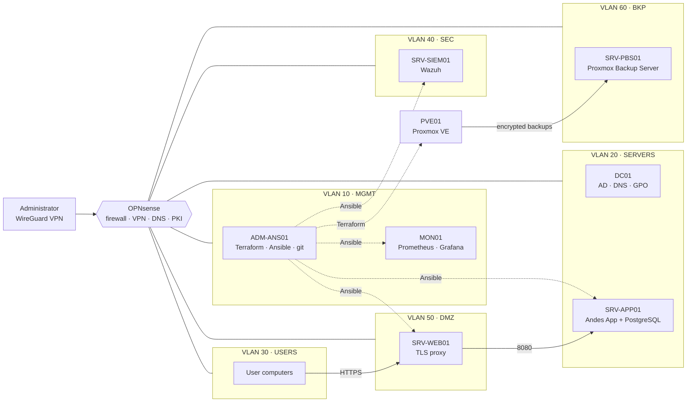

🇺🇸 **English** · 🇪🇸 [Español](README.es.md)

# Andes Homelab · company infrastructure built, automated and recovered on one laptop

[](https://github.com/GUAR-NIX/ANDES-HOMELAB/actions/workflows/ci.yml)

Segmented network, Active Directory, own PKI, infrastructure as code, CI/CD, observability, SIEM and disaster recovery for
a fictional company (**Andes Logística**, domain `corp.lab.internal`), run on a laptop with Proxmox VE nested inside VMware
Workstation. **This is a lab**, not a production environment: private addresses, internal domain and evaluation licenses.

| What was demonstrated | Measured | Evidence (Spanish) |
|---|---|---|
| Server destroyed and rebuilt from Git with Terraform and Ansible | **7 min 19 s**, no manual steps | [ADR-0005](docs/adr/ADR-0005-terraform-bpg.md) |
| Disaster recovery drills | **6 of 6** passed; VM restored in 5 min 19 s | [Drill log](docs/dr/resultados-simulacros.md) |
| Vulnerabilities after one patching cycle | **−79%** (19,784 → 4,062) in 1 h 06 min | [Guide, phase 7](docs/GUIA-DEL-PROYECTO.md) |
| Unauthorized web change, simulated incident | SIEM alert in **5 s**, service restored in 26 min | [INC-0001](docs/incidents/INC-0001.md) |
| Server hardening (Lynis audit) | **63 → 83** | [Guide, phase 4](docs/GUIA-DEL-PROYECTO.md) |

## Start here

| If you have… | Go to |
|---|---|
| **3 minutes** | [Demo video (3:26, in Spanish)](https://youtu.be/rV9RyCcJ3Nk) or [In 30 seconds](#in-30-seconds-for-non-technical-readers) |
| **Interest in the code** | [Terraform](terraform) · [Ansible roles](ansible/roles) · [rebuild script](scripts/reconstruir-servidor.sh) |
| **Interest in tests and CI** | [Workflow](.github/workflows/ci.yml): gitleaks, Terraform, ansible-lint, Trivy · [runs](https://github.com/GUAR-NIX/ANDES-HOMELAB/actions) |
| **Interest in the design** | [Architecture](#architecture) · [8 decision records](docs/adr/README.md) · [diagrams](docs/diagramas/README.md) |
| **Interest in operations** | [Runbooks](docs/runbooks/README.md) · [drill results](docs/dr/resultados-simulacros.md) · [incident report](docs/incidents/INC-0001.md) |
| **Time for the whole story** | [Project guide](docs/GUIA-DEL-PROYECTO.md) · [build log, 185 pages and 434 screenshots](BITACORA-PASO-A-PASO.pdf) ([what was redacted and why](docs/bitacora/README.md)) |

This page is in English; the linked documents (guide, ADRs, runbooks, reports) are in Spanish.

> **Public version.** Same code and documentation as the working repository, without its history and without the two
> files encrypted with Ansible Vault (the secrets and the OPNsense backup). Their structure is documented in
> [vault.yml.example](ansible/group_vars/all/vault.yml.example) and [backups/opnsense](backups/opnsense/README.md).

## My role

Personal project by **Erick Guarnizo**, owned end to end: network and identity design, Terraform and Ansible code, CI,
monitoring, detection rules, the simulated incident, the recovery drills and the documentation. There was no client, team
or real user traffic. The workloads belong to a fictional company.

## Key decisions

| Decision | Why | Record |
|---|---|---|
| Deny by default between six VLANs, with 12 documented flows | A compromised user or DMZ host must not reach the servers | [ADR-0002](docs/adr/ADR-0002-seis-vlan.md) |
| Import the existing VMs into Terraform instead of recreating them | Bring working servers under code without rebuilding them | [ADR-0005](docs/adr/ADR-0005-terraform-bpg.md) |
| Terraform state outside Git, with a minimum-role API token | The state holds configuration and sensitive values | [ADR-0004](docs/adr/ADR-0004-estado-terraform.md) |
| Two-tier PKI | If the issuing CA is compromised, the root of trust survives | [ADR-0006](docs/adr/ADR-0006-ca-intermedia.md) |
| Encrypted firewall backup in Git instead of the usual plugin | The plugin stores the configuration, with keys, in clear text | [ADR-0008](docs/adr/ADR-0008-opnsense-xml-cifrado.md) |

## Trade-offs

- **Nested virtualization on one laptop:** it kept the laptop usable every day, at the cost of performance, high availability and a
  20 GB memory budget ([ADR-0001](docs/adr/ADR-0001-proxmox-anidado.md)).
- **Server Core for the domain controller:** fewer patches and less memory, but no graphical console
  ([ADR-0003](docs/adr/ADR-0003-server-core.md)).
- **Backups and SIEM take turns:** they do not fit in memory together, so the SIEM is off about 6 minutes a day
  ([ADR-0007](docs/adr/ADR-0007-pbs-ventana-copias.md)).
- **No off-site copy:** both backup copies share the physical disk; an accepted, documented risk.
- **Rebuild or restore:** rebuilding gives a clean server but loses what is not in code; restoring is faster and keeps
  everything, including a possible compromise ([comparison](docs/dr/resultados-simulacros.md)).

## What failed

- **The alert reached nobody.** The SIEM detected the change in 5 s, but nobody was notified of it, and availability monitoring
  saw `200 OK`. Detection without paging is not response ([INC-0001](docs/incidents/INC-0001.md)).
- **A rebuilt server was left out of the domain.** The AD join was manual. It became the [`ad_member`](ansible/roles/ad_member)
  role with a delegated account, and the test was repeated.
- **The recovery point was 12 h.** In drill DR-03, 5 of the 10 rows (those written after the last dump) were lost, within
  the 24 h objective.
- **The vault password existed only inside the lab.** Drill DR-04 exposed it: if the firewall falls, it cannot be reached.
- **DR-04 was a partial drill.** The firewall was restored and checked in isolation, without swapping the live one.

More cases: [Real problems that had to be solved](#real-problems-that-had-to-be-solved).

## How results were measured

| Result | Method |
|---|---|
| Rebuild time | Elapsed time printed by the [rebuild script](scripts/reconstruir-servidor.sh); logged as change [CHG-0012](docs/cambios/README.md) |
| Recovery drills | Timed, and compared with an objective where one was defined; destructive drills only after the backup was verified ([log](docs/dr/resultados-simulacros.md)) |
| Detection and response | Event times in the SIEM and system logs, UTC timeline in [INC-0001](docs/incidents/INC-0001.md). One exercise, not an average |
| Vulnerabilities | Vulnerability inventory in the SIEM before and after the patching change [CHG-7.4-01](docs/cambios/README.md) |
| Hardening | Lynis and CIS Ubuntu 24.04 audits before and after ([guide, phase 4](docs/GUIA-DEL-PROYECTO.md)) |

---

## In 30 seconds (for non-technical readers)

Imagine a logistics company with offices, employees, a website for its customers and data to protect. It needs a
**network** that keeps employees away from the servers, centralized **user accounts**, a **web application** published to
the Internet, someone **watching** that everything works, a system that **detects attacks**, and **backups** in case
something goes wrong.

This project builds **all of that from scratch**, the way the IT department of a real company would, but inside a single
laptop. And it does not stop at "installing it": it is **automated** (servers are created and configured by themselves
from code), **attacked** (an incident is simulated and the time to detect it is measured) and **broken on purpose**
(servers are destroyed and recovered, against the clock).

The measured results are in the table at the top of this page. Full explanation, phase by phase, including the real problems that had to be solved:
**[Project guide (Spanish)](docs/GUIA-DEL-PROYECTO.md)**. The whole process with 434 screenshots:
**[Implementation log (PDF, 185 pages, Spanish)](BITACORA-PASO-A-PASO.pdf)**. Unfamiliar term?
**[Glossary (Spanish)](docs/GLOSARIO.md)**.

---

## The fictional company: Andes Logística

| Area | What the company needs | How it was solved |
|---|---|---|
| Network | An infected employee computer must not reach the servers | 6 separate networks (VLANs) with a firewall between them that blocks everything except what is authorized |
| Remote access | The administrator must connect securely | WireGuard VPN: the **only** administration entry point |
| Users | One account per employee and permissions by department | Active Directory with groups, policies (GPO) and Linux servers joined to the domain |
| Customer website | Publish the application without exposing the database | Containerized application behind a proxy in an isolated zone (DMZ) with HTTPS |
| Certificates | All internal connections must be encrypted | Own certificate authority (root + issuing) |
| Monitoring | Know that something is failing before customers complain | Prometheus + Grafana with Telegram alerts and a 99% availability objective |
| Security | Detect attacks and respond | Wazuh SIEM with rules mapped to MITRE ATT&CK, simulated incident with a report |
| Continuity | Survive the loss of a server | Encrypted, verified nightly backups in Proxmox Backup Server, 3-2-1 rule, drills |
| Order | Someone else must be able to operate it | Documented decisions (ADRs), procedures (runbooks), change management and automatic inventory |

## Architecture



**How to read the diagram.** Everything lives inside a Windows 11 laptop: VMware runs **Proxmox VE** (the "company"
hypervisor) and Proxmox runs the 10 virtual machines. The **OPNsense** firewall is the only path between networks. Each
network has a purpose:

| VLAN | Network | Purpose | Who lives there |
|---|---|---|---|
| 10 MGMT | 10.10.10.0/24 | Administration: everything is managed from here | ADM-ANS01 (Terraform, Ansible), MON01 (monitoring) |
| 20 SERVERS | 10.10.20.0/24 | Internal servers | DC01 (Active Directory), SRV-APP01 (application + database) |
| 30 USERS | 10.10.30.0/24 | Employee computers | DHCP clients |
| 40 SEC | 10.10.40.0/24 | Security, isolated from the rest | SRV-SIEM01 (Wazuh) |
| 50 DMZ | 10.10.50.0/24 | What is published to the outside | SRV-WEB01 (HTTPS proxy) |
| 60 BKP | 10.10.60.0/24 | Backups, the most isolated | SRV-PBS01 (Proxmox Backup Server) |

Golden rule: **everything is blocked between networks except 12 documented flows** (for example: "employees may open the
website over HTTPS"). If the DMZ web server is compromised, it cannot reach the domain controller: this was tested. More
diagrams (firewall flows, dependencies, backups, change flow): [docs/diagramas](docs/diagramas/README.md).

## How it was built: 11 phases

Each phase builds on the previous one. The detail (goal, decisions, real problems and result) is in the
**[project guide](docs/GUIA-DEL-PROYECTO.md)**.

| Phase | What was built | Key result |
|---|---|---|
| 0 · Host | Prepare the laptop for nested virtualization | Proxmox can run VMs inside VMware |
| 1 · Hypervisor | Proxmox VE 9 and an Ubuntu template with cloud-init | A new server ready in minutes |
| 2 · Network | OPNsense, 6 VLANs, flow matrix, DNS and VPN | Deny by default between networks |
| 3 · Identity | Active Directory, GPO and Linux joined to the domain | One user, one password, permissions by group |
| 4 · Servers | Hardened Linux and internal PKI | Lynis 63 → 83, TLS on every service |
| 5 · Applications | Dockerized app + proxy in the DMZ | Rootless containers, scanned image |
| 6 · Observability | Metrics, alerts and SLO | Telegram alerts, 99% SLO |
| 7 · Defensive security | SIEM, vulnerabilities and simulated incident | Detection in 5 s, vulnerabilities −79% |
| 8 · Automation | Terraform, Ansible and CI in GitHub Actions | Server rebuilt from git in 7 min 19 s |
| 9 · Backups and DR | Proxmox Backup Server and drills | 6/6 drills passed |
| 10 · Operations | Runbooks, changes, inventory and routines | Automatic reviews with reports in git |
| 11 · Publication | Secrets review, README and video | This repository, audited with gitleaks |

## Measured results

| Area | Result |
|---|---|
| Infrastructure | 10 VMs on Proxmox, 6 VLANs and 12 documented firewall flows; deny by default between segments |
| Infrastructure as code | Server destroyed and rebuilt from git in **7 min 19 s** with no manual steps; new VM in 2 min 31 s; second Ansible run with `changed=0` |
| CI/CD | gitleaks (full history), Terraform, ansible-lint (*production* profile), Trivy and publication of the app image to GHCR; actions pinned by SHA |
| Hardening | Lynis 63 → **83**; CIS Ubuntu 24.04 from 53% to **63%**; SSH with keys only, and only from the management network and the VPN |
| Vulnerabilities | **−79%** overall (19,784 → 4,062), critical **−89%**, high −83% in a 1 h 06 min patching cycle |
| Detection | Wazuh with 6 use cases mapped to MITRE ATT&CK and 2 custom rules; simulated incident with **MTTD 5 s** and MTTR 26 min |
| Observability | Prometheus, Grafana and Alertmanager; 99% availability SLO with a weekly report |
| Disaster recovery | 6 drills passed: VM restored in **5 min 19 s**, server rebuilt + database in 7 min 11 s (RPO 12 h), firewall in 3 min 38 s, AD user in 0.05 s, corrupt backup detected and repaired |
| Operations | Patching with Ansible, automatic weekly and access reviews with reports in git, hypervisor capacity in Grafana |

Detail of each measurement: [docs/dr/resultados-simulacros.md](docs/dr/resultados-simulacros.md),
[docs/incidents/INC-0001.md](docs/incidents/INC-0001.md), [docs/operacion](docs/operacion/README.md).

## Real problems that had to be solved

A lab that "works the first time" does not teach much. These are some real problems, how they were diagnosed and what
was changed so they do not happen again (detail in the [guide](docs/GUIA-DEL-PROYECTO.md)):

| Problem | Cause | Permanent fix |
|---|---|---|
| The SIEM kept running out of memory | Proxmox *ballooning* was taking RAM away from Wazuh | Fixed memory for the SIEM and power-on profiles |
| After a power cut, the VPN and certificates failed | Every clock in the lab was 2 h 46 min behind | Resync procedure (Proxmox, OPNsense, DC01) documented as an emergency change |
| A server rebuilt from code was left out of the domain | Joining Active Directory had been done by hand | New `ad_member` Ansible role with a least-privilege delegated account |
| The hypervisor stopped booting after adding a disk | The BIOS changed the boot order | Boot order pinned and a warning in the script that adds disks |
| Patching left services "down" | A recommended package (`ipmitool`) installed a service without hardware | The patching role purges it and verifies 0 failed units |
| The SIEM and the backup server did not fit at the same time | 20 GB of RAM for 10 VMs | Daily backup window at 22:00: the SIEM shuts down, everything is backed up and it starts again |

## What is where

| Skill | What was done | Where |
|---|---|---|
| Virtualization | Nested Proxmox VE 9, cloud-init templates, power-on profiles | [ADR-0001](docs/adr/ADR-0001-proxmox-anidado.md) |
| Networking and perimeter security | OPNsense, 6 VLANs, flow matrix, WireGuard VPN as the only administration path | [ADR-0002](docs/adr/ADR-0002-seis-vlan.md) |
| Identity | AD on Windows Server Core, AGDLP, GPO, delegation, Linux joined with SSSD/Kerberos | [ADR-0003](docs/adr/ADR-0003-server-core.md), [ad_member role](ansible/roles/ad_member) |
| PKI | Own root + issuing CA; TLS on every internal service | [ADR-0006](docs/adr/ADR-0006-ca-intermedia.md) |
| Infrastructure as code | Terraform (bpg/proxmox) importing existing VMs; state outside Git | [terraform/](terraform), [ADR-0004](docs/adr/ADR-0004-estado-terraform.md), [ADR-0005](docs/adr/ADR-0005-terraform-bpg.md) |
| Configuration management | Ansible: 9 idempotent roles, secrets in Vault, rebuild in one command | [ansible/](ansible), [scripts/reconstruir-servidor.sh](scripts/reconstruir-servidor.sh) |
| CI/CD and supply chain security | GitHub Actions with gitleaks, lint, Trivy and image on GHCR | [.github/workflows/ci.yml](.github/workflows/ci.yml) |
| Containers | Andes App (Flask + PostgreSQL) in rootless, read-only Docker, scanned image | [andes_app role](ansible/roles/andes_app) |
| Observability | Metrics, Telegram alerts, SLO, host capacity | [monitoring/](monitoring), [docs/operacion/capacidad.md](docs/operacion/capacidad.md) |
| SIEM and response | Wazuh, FIM with who-data, active response, runbook and post-mortem | [RB-IR-01](docs/runbooks/RB-IR-01.md), [INC-0001](docs/incidents/INC-0001.md) |
| Backups and continuity | Encrypted Proxmox Backup Server, 3-2-1 rule, daily backup window, continuity plan | [docs/dr](docs/dr/plan-continuidad.md), [ADR-0007](docs/adr/ADR-0007-pbs-ventana-copias.md) |
| Operations | ADRs, runbooks, change management, automatic inventory, scheduled routines | [docs/](docs/README.md) |

## Repository map

```
.
├── BITACORA-PASO-A-PASO.pdf   The complete process: 185 pages and 434 screenshots (Spanish)
├── terraform/          Virtual machines declared as code (Proxmox)
├── ansible/            Server configuration in 9 roles + playbooks
│   ├── roles/          hardening, ad_member, andes_app, nginx_proxy, wazuh_agent, node_exporter, patching…
│   └── group_vars/     Variables (secrets are encrypted with Vault; only the template is here)
├── .github/workflows/  CI: gitleaks, Terraform, ansible-lint, Trivy and image publication
├── monitoring/         Prometheus (rules, alerts, SLO) and Grafana dashboards
├── scripts/            Rebuild servers, check services, inventory, automatic reviews, backups
├── web/                DMZ proxy configuration
├── baseline/           Configuration baseline (source of truth for incident response)
├── backups/opnsense/   Encrypted firewall backup (not included in the public version)
└── docs/
    ├── GUIA-DEL-PROYECTO.md   The whole story, phase by phase
    ├── GLOSARIO.md            Technical terms explained
    ├── bitacora/       What was hidden in the public build log and why
    ├── adr/            Why each design decision was made
    ├── runbooks/       How each task is done, step by step
    ├── cambios/        Log of the 19 changes made
    ├── incidents/      Simulated incident report
    ├── dr/             Continuity plan and recovery drills
    ├── diagramas/      Network, dependencies, backups and change flow
    ├── operacion/      Routines, weekly reports, access review, capacity
    └── inventario/     Automatically generated inventory
```

## How to reproduce it

**Requirements:** a PC with 32 GB of RAM, a CPU with nested virtualization (AMD-V/VT-x), about 400 GB free and VMware
Workstation. On Windows, memory integrity (HVCI) must be disabled so VMware can expose virtualization.

**Build order** (each step depends on the previous one):
1. Proxmox VE as a VMware VM and an Ubuntu 24.04 template with cloud-init.
2. OPNsense: VLANs, flow matrix, DNS/NTP and WireGuard VPN.
3. DC01 (Windows Server Core) and the domain; PKI on OPNsense.
4. ADM-ANS01 as the single administration point; from there, Terraform and Ansible:
   ```bash
   source ~/.secrets/pve-terraform.env          # Proxmox token (never in the repository)
   terraform -chdir=terraform apply             # VMs declared in servers.auto.tfvars
   cd ansible && ansible-playbook site.yml      # baseline, agents, Docker, app, proxy, AD join
   ```
5. Monitoring, SIEM and Proxmox Backup Server; then the routines in [docs/operacion](docs/operacion/README.md).

Before step 4, create your own secrets from [vault.yml.example](ansible/group_vars/all/vault.yml.example). To operate it:
[docs/README.md](docs/README.md) (first steps) and [docs/runbooks](docs/runbooks/README.md).

## Limitations (honest ones)

- **A single physical host** with nested virtualization: no real high availability and some performance overhead.
- **Tight memory** (20 GB for everything): the SIEM and the backup server do not fit at the same time and take turns in a
  daily window; new VMs require power-on profiles.
- **Backups on the same physical disk** (the second copy, in another folder of the host); no off-site copy (accepted risk).
- **Evaluation licenses** of Windows Server and a non-public `.internal` domain.
- Production would require: a 3-node cluster with shared storage (Ceph), a second domain controller, a distributed SIEM,
  an encrypted off-site copy and enforced branch protection.

## Author and license

Project designed, built, automated and documented by **Erick Guarnizo**.

Code under [MIT](LICENSE); documentation under [CC BY 4.0](https://creativecommons.org/licenses/by/4.0/). If you reuse
anything, cite the source: *Erick Guarnizo, Andes homelab, github.com/GUAR-NIX/ANDES-HOMELAB*.
