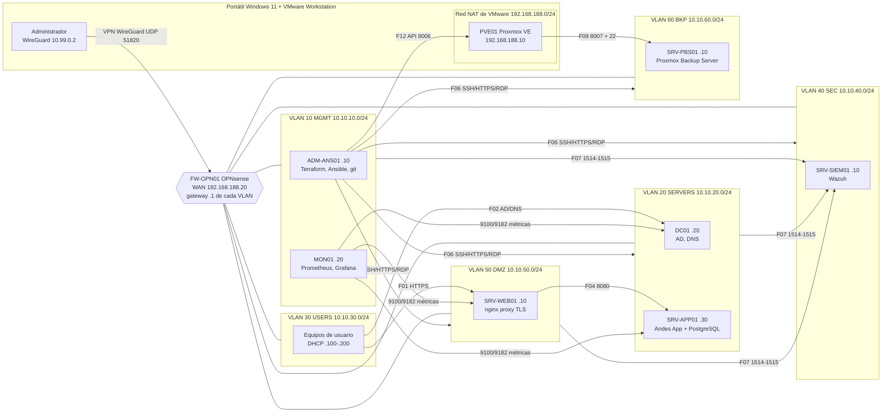
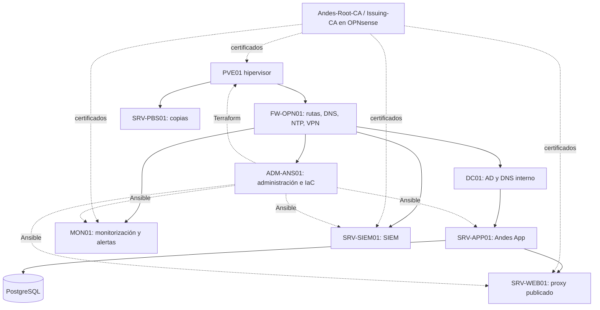
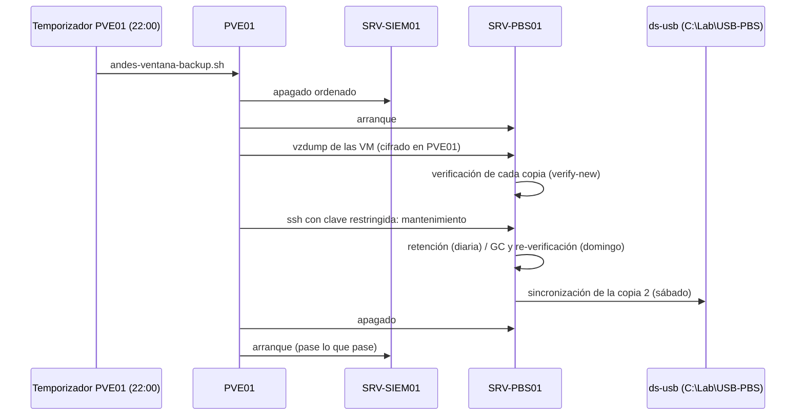
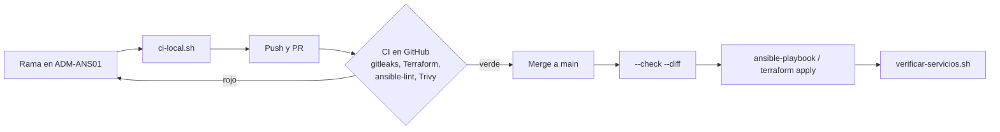

# Diagramas

Diagramas en Mermaid, versionados con el código: GitHub los dibuja al abrir este archivo. Si cambia la red o un servicio,
se actualizan en el mismo PR que el cambio.

## 1. Red (capa 3) y flujos permitidos

Todo el tráfico entre VLAN está bloqueado (F03/F05) salvo los flujos dibujados. La administración entra solo por la VPN.

## 2. Dependencias entre servicios

Orden de recuperación ante una pérdida total: PVE01 y PBS → firewall → DC01 → ADM-ANS01 → app → web →
monitorización y SIEM (docs/dr/plan-continuidad.md).

## 3. Flujo de las copias (ventana diaria de las 22:00)

## 4. Flujo de un cambio de configuración

